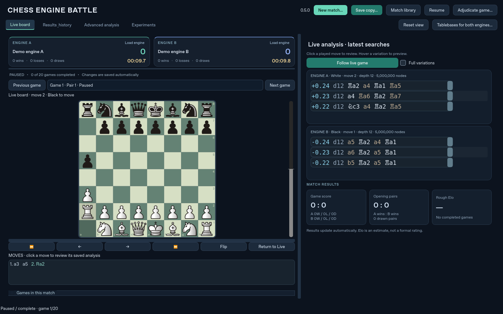

# Chess Engine Battle

A standalone Python 3.12 / PySide6 desktop application built on the latest audited
Nocturne Chess implementation. No chess engines or NNUE networks are bundled.

## Build downloads

- [Download Chess Engine Battle 0.5.10 rebuild for Windows](https://github.com/understandingothers789-pixel/ChessEngineBattle/actions/runs/43341184799/artifacts/13999008198) — fresh build with the softer divergence highlight, file revision 0.5.10.1. Windows tests and packaged startup checks passed. Unsigned; Smart App Control acceptance is unverified. Extract the full ZIP. GitHub sign-in required; Actions downloads expire.

- [Download Chess Engine Battle 0.5.10 for Windows](https://github.com/understandingothers789-pixel/ChessEngineBattle/actions/runs/43339730994/artifacts/13997888971) — softer teal highlight for main variation divergence. Windows tests and packaged startup check passed. Extract the full ZIP. GitHub sign-in required; Actions downloads expire.

- [Download Chess Engine Battle 0.5.9 rebuilt from 0.5.8 for Windows](https://github.com/understandingothers789-pixel/ChessEngineBattle/actions/runs/43339068640/artifacts/13997753518) — recreate from 0.5.8, reapplying recorded nodes and highlighted divergence; file revision 0.5.9.2. Windows tests and packaged startup checks passed. Unsigned; Smart App Control acceptance remains unverified. Extract the full ZIP. GitHub sign-in required; Actions downloads expire.

- [Download Chess Engine Battle 0.5.9 rebuild for Windows](https://github.com/understandingothers789-pixel/ChessEngineBattle/actions/runs/43331855895/artifacts/13995402281) — fresh rebuild with the 0.5.8 packaging setup, including recorded nodes and highlighted divergence. File revision 0.5.9.1. Windows tests and packaged startup checks passed. The executable is unsigned; Smart App Control acceptance is unverified. Extract the full ZIP. GitHub sign-in required; Actions downloads expire.

- [Download Chess Engine Battle 0.5.9 for Windows](https://github.com/understandingothers789-pixel/ChessEngineBattle/actions/runs/43317072760/artifacts/13989496217) — recorded node counts in review and highlighted main-line divergence markers. Windows tests and packaged startup check passed. Extract the entire ZIP. GitHub sign-in required; Actions downloads expire.

- [Download Chess Engine Battle 0.5.8 for Windows](https://github.com/understandingothers789-pixel/ChessEngineBattle/actions/runs/43314656322/artifacts/13987961180) — clearer paused status, immediate reviewed-clock updates and fewer repeated graph database reads. Windows tests and packaged startup check passed. Extract the whole ZIP. GitHub sign-in required; Actions downloads expire.

- [Download Chess Engine Battle 0.5.7 for Windows](https://github.com/understandingothers789-pixel/ChessEngineBattle/actions/runs/43313400809/artifacts/13987291457) — yellow scorecard clocks now show the selected review move and remain live when following the current move. Windows tests and packaged startup check passed. Extract the entire ZIP. GitHub sign-in required; Actions downloads expire.

- [Download Chess Engine Battle 0.5.6 for Windows](https://github.com/understandingothers789-pixel/ChessEngineBattle/actions/runs/43312038660/artifacts/13985643424) — adds an adjustable move buffer, defaulting to 0.20 seconds, and shows the active engine clock beside live search details. Windows tests and packaged startup check passed. Extract the entire ZIP. GitHub sign-in required; Actions artifacts expire.

- [Download Chess Engine Battle 0.5.5 for Windows — move timing and main line divergence](https://github.com/understandingothers789-pixel/ChessEngineBattle/actions/runs/43299757409/artifacts/13981935444) — review recorded time per move and mark the first divergence between rank one main variations with @ when aligned to the same position. Windows tests, packaging and startup/render checks passed. Extract the full ZIP. GitHub sign-in required; Actions artifacts expire.

- [Download Chess Engine Battle 0.5.5 for Windows](https://github.com/understandingothers789-pixel/ChessEngineBattle/actions/runs/43291879267/artifacts/13977492109) — redesigned evaluation graph with adaptive scaling, labeled moves, hover details and distinct engine lines. Windows tests and packaged startup checks passed. Extract the entire ZIP. GitHub sign-in required; Actions downloads expire.

- [Download Chess Engine Battle 0.5.4 rebuild for Windows](https://github.com/understandingothers789-pixel/ChessEngineBattle/actions/runs/43181330706/artifacts/13926696309) — fresh build using the 0.5.2 packaging specification and workflow, retaining current features. File revision 0.5.4.1. Windows tests and packaged startup checks passed; unsigned, so Smart App Control acceptance is unverified. Extract the entire ZIP. GitHub sign-in required; Actions downloads expire.

- [Download Chess Engine Battle 0.5.4 for Windows](https://github.com/understandingothers789-pixel/ChessEngineBattle/actions/runs/43180551351/artifacts/13925059562) — drawn games show the largest advantage supported by both engines, with their scores and the move. Windows tests, packaging and startup checks passed. Extract the entire ZIP. GitHub sign-in is required; Actions downloads expire.

- [Download Chess Engine Battle 0.5.3 for Windows](https://github.com/understandingothers789-pixel/ChessEngineBattle/actions/runs/43178985120/artifacts/13925187681) — evaluation graph by move, configurable automatic draw starting at move 30 with ±0.30 evaluations, tablebase hits, and game ending reasons. Windows tests, packaging and startup/render checks passed. Extract the entire ZIP; GitHub sign-in is required and Actions downloads expire.

- [Download Windows 0.5.2 recreated from 0.5.1 — rebuild 3](https://github.com/understandingothers789-pixel/ChessEngineBattle/actions/runs/43153440423/artifacts/13914513533) — restored exact 0.5.1 application and packaging files, then reapplied the best-line history feature and version labels. Verified 44 unchanged baseline files byte-for-byte; uses the original 0.5.1 Windows workflow. File revision **0.5.2.2**. 120 Windows tests passed, 1 optional real-engine test skipped; packaging and executable startup/render smoke passed. Source `087295ef2620406987bea296c0ebc4f236383793`. Still unsigned: Smart App Control acceptance remains unverified. Extract the whole ZIP into a fresh folder. GitHub sign-in required; Actions downloads expire.

### 0.5.0 — Match Studio



*UI preview rendered with deterministic demo engines; not a real engine-strength comparison.*

The dark studio uses mint and blue engine scorecards with points, W/L/D and live
clocks, a completion progress bar, focused analysis cards, and game/pair/Elo result
cards. **Load engine** on each scorecard selects your local executable. **New
match…** opens numbered setup sections; advanced position tools are optional.

Use the top navigation for **Live board**, **Results & history**, **Advanced
analysis** and **Experiments**. The game picker uses readable results such as
White won, Black won and Draw. Click a played move for recorded analysis and use
**Follow live game** to return to play. **Save copy…** creates the same portable
`.cebattle` match file as the earlier Save match button; automatic local saving
continues. **Match library** opens past tournaments. **Reset view** and shared
**Tablebases** remain visible. Existing profiles, history and settings are retained.

Shortcuts: **Ctrl+N** setup, **Ctrl+O** library, **Ctrl+Shift+S** save copy,
**F9** follow live. The workspace fits 1280×800 and grows at larger sizes; the
analysis side scrolls when necessary. Windows packaging and startup validation passed; the download is above.


- [Download Chess Engine Battle 0.4.2 for Windows — dark theme, reset and shared tablebases](https://github.com/understandingothers789-pixel/ChessEngineBattle/actions/runs/43132117205/artifacts/13905986693) — dark by default; Reset view; always-visible previous/next game picker; game and completed-pair W/L/D plus rough Elo difference; shared Syzygy folder setup for the next new match, preserving existing paths unless replaced. 116 Windows tests passed, 1 optional real-engine test skipped; packaging and startup/render checks passed. [Source: 188480e](https://github.com/understandingothers789-pixel/ChessEngineBattle/commit/188480ea88b7a7e6632015a63ef9002132c5ba49). Unsigned; GitHub sign-in required; Actions downloads expire. Tablebase configuration/protocol was tested with a fixture; actual five-piece probing requires the user's engine and tablebase files.

### 0.4.2 — dark default, reset view, game navigation and tablebases

**Reset view** restores pane sizes, compact variations, column fitting and live
following without stopping the match. The game picker and Previous/Next game
buttons stay above the board even when the table is hidden. Select any game and
click its moves to review the recorded analysis; Follow live game returns to play.

Results show game wins/losses/draws for both A and B, completed two-game pair
wins/losses/draws, and a rough A-minus-B Elo difference from all completed game
points. Incomplete pairs do not count toward pair results. The Elo estimate is
unstable with small samples and is not a formal rating. A perfect or zero score
has no finite estimate and is labeled unbounded.

**Tablebases for both engines…** selects a Syzygy folder for the next new match.
Choose the folder directly containing `.rtbw` files (and `.rtbz` files if
available), not a parent folder containing subfolders. Existing engine paths are
kept unless Replace existing paths is enabled. Each engine is checked for its
advertised SyzygyPath option; unsupported engines are reported and left unchanged.
Supported probe limits are set up to five pieces. These settings update saved
profiles, not a match already in progress. Start a new match to use them; the
start review shows the configured paths. Files must cover the actual position;
selecting a folder does not verify that the entire five-piece set is complete.
Non-Syzygy formats require a compatible engine and its own settings.


- [Download Chess Engine Battle 0.4.1 for Windows — score and layout controls](https://github.com/understandingothers789-pixel/ChessEngineBattle/actions/runs/43129855721/artifacts/13904807144) — prominent A/B points, wins and draws; draggable horizontal/vertical pane dividers; compact auto-fit game columns, Fit columns button and smoother pixel scrolling with larger handles. Pane sizes and column widths persist. 112 Windows tests passed, 1 optional real-engine test skipped; packaging and startup/render checks passed. [Source: 27c924b](https://github.com/understandingothers789-pixel/ChessEngineBattle/commit/27c924b44169357745dcfe2a45d7ec224ff6f3d1). Unsigned; GitHub sign-in required; Actions downloads expire.

Drag the wide dividers between the board/analysis and above the moves/table area
to resize the panes. Expand Games in this match to see the game table. Columns
start compact; use **Fit columns** to reset them, drag a header divider to resize,
or double-click a divider to fit that column. Hover shortened text for its full
value. The score follows Engine A/B when colors swap and also shows saved-match
results. Existing compact variations, saved matches and portable files remain
available.

- [Download Chess Engine Battle 0.4.0 for Windows — compact UI and saved tournaments](https://github.com/understandingothers789-pixel/ChessEngineBattle/actions/runs/43128956101/artifacts/13905175104) — shorter variation previews with a Full variations option, more room for the board, light slate/teal styling and clearer match status. Save match writes a portable tournament with its recorded analysis; Saved matches reopens previous tournaments and match files for per-move/depth review. 111 Windows tests passed, 1 optional real-engine test skipped; packaging and startup/render checks passed. [Source: a3bccb5](https://github.com/understandingothers789-pixel/ChessEngineBattle/commit/a3bccb598f7e0a199bd1f7d8c163e85eba25fd81). Unsigned; GitHub sign-in required; Actions downloads expire.

### 0.4.0 — compact match view and portable saved tournaments

Variation previews show **3 full moves** by default. Enable **Full variations**
for longer lines; the complete engine data is saved either way. The light slate /
teal theme, forest board and progress banner emphasize match play.

**Save match…** writes a `.cebattle` file with the selected tournament's moves,
results, clocks, final variations, recorded depth history and node checkpoints.
Saving briefly pauses a running match, then resumes it. Keep this file wherever
you keep your backups. **Saved matches…** lists previous tournaments from the
automatic local library, or use **Open match file…** to reopen a portable copy.
Choose a game, click a move, then select a saved depth to inspect its variations.
An imported copy has its own identity and opens for review without launching
engines or replacing local history. To play again, select local engines in Match
setup and start a new match. Local library matches remain resumable.

The file contains the analysis that was actually recorded; it cannot reconstruct
missing history from older versions. PGN/CSV exports remain available, but use
Save match for a complete, reopenable tournament with its engine analysis.


- [Download Chess Engine Battle 0.3.9 for Windows — improved UI and saved move analysis](https://github.com/understandingothers789-pixel/ChessEngineBattle/actions/runs/43125865269/artifacts/13902667576) — board/moves on the left, analysis on the upper right; click moves to review final MultiPV lines and saved depths; top-bar Pause/Resume, separate setup window, floating previews and clearer help. Saved analysis survives reopening. 107 Windows tests passed, 1 optional real-engine test skipped; packaging and startup/render checks passed. [Source: 428fbea](https://github.com/understandingothers789-pixel/ChessEngineBattle/commit/428fbea99745945ec8472f5ef1409f5b8766f9bf). Unsigned; GitHub sign-in required; Actions downloads expire.

### 0.3.9 — clearer match workspace and saved variations

Board and moves stay on the left; analysis stays on the upper right. **Match
setup…** opens a separate window. **Pause/Resume** is always in the top bar.
Click a move or use the arrow keys to review its saved analysis. Each engine panel
shows the latest recorded search through that move (the engines search alternating
positions). Choose **Final variations**, an earlier **Depth**, or a stored node
checkpoint, then hover a variation move for a board preview. **Follow live game**
returns to the current game. Reviewing history does not pause a running match.

Final lines are stored automatically for every engine move. This version also
stores complete MultiPV sets at reported depths 1–128; incomplete/mixed-depth sets
are not presented as complete. Older games retain whatever final lines and node
checkpoints were recorded at the time; missing depth history cannot be recovered.
Book moves have no engine search. Analysis lives with your games in `battle.sqlite`
in the existing library folder described under Persistence and exports.


New builds use **main**. Each entry below records the version, Windows download,
and brief change notes; previous downloads remain available. See
[CHANGELOG.md](CHANGELOG.md) for the concise version history.

- [Download Chess Engine Battle 0.3.8 for Windows](https://github.com/understandingothers789-pixel/ChessEngineBattle/actions/runs/43123994831/artifacts/13901768232) — renamed the app, dialogs and executable (`ChessEngineBattle.exe`); brought the latest features and build history onto **main**, which now handles future builds. Saved engines, settings and games remain available. 104 Windows tests and packaged startup/render checks passed; 1 optional real-engine test skipped. [Source: 40a8d01](https://github.com/understandingothers789-pixel/ChessEngineBattle/commit/40a8d010399c159cbae53c78382ffcdeab56be53). Unsigned. GitHub sign-in is required; Actions downloads expire.

Historical downloads through 0.3.7 use the previous executable name
`NocturneBattle.exe`. The existing library location is retained across the rename
so your saved engines, settings and games remain available.

- [Download Windows 0.3.7 — live thinking and adjudication](https://github.com/understandingothers789-pixel/ChessEngineBattle/actions/runs/43122316818/artifacts/13901312381) — application only, approximately 51.2 MiB. Source `57b22dd1aa195b4b47c271b0b6f25b9c2be3d17a`. 104 Windows tests passed, 1 optional real-engine test skipped; packaging and executable startup/render smoke passed. Unsigned; interactive Windows security acceptance remains unverified. Sign in to GitHub; Actions artifacts expire.

- [Download separate opening books](https://github.com/understandingothers789-pixel/ChessEngineBattle/actions/runs/43121987151/artifacts/13900233891) — approximately 149 KiB compressed, three CC0 EPD suites and license/source notes. Extract once to a permanent folder and choose an EPD with Browse opening suite. These files are excluded from application downloads and future app updates. The separate book workflow runs only when explicitly requested or when its release workflow file changes. Sign in to GitHub; Actions artifacts expire.

See [0.3.7 behavior and validation](docs/0.3.7_REPORT.md).

- [Download Windows 0.3.5 — opening rematches and increment clocks](https://github.com/understandingothers789-pixel/ChessEngineBattle/actions/runs/42558691472/artifacts/13648666558) — full-book two-game setup, independent base-plus-increment clocks and live time displays. Source `aceb021db4f5bcaf24f5ff25ddf1653f44bf0ab7`. 87 tests passed, 1 optional real-engine test skipped; Windows packaging and startup/render smoke passed. Sign in to GitHub; Actions artifacts expire. Unsigned; interactive Windows/Smart App Control acceptance requires local testing.

- [Download Windows 0.3.4 — combined features on the working 0.3.1 build baseline](https://github.com/understandingothers789-pixel/ChessEngineBattle/actions/runs/42556560195/artifacts/13648205211) — includes the 0.3.2 tooltips and 0.3.3 speed/bug fixes. Source `06b4835a1af3a70c5d03dfd7809ac1bef0aa6940`. 73 tests passed, 1 optional real-engine test skipped; Windows packaging/startup smoke passed. The 0.3.1 packaging specification is retained; the executable is new and unsigned, so Smart App Control acceptance is unverified. Sign in to GitHub; Actions artifacts expire.

- [Download Windows 0.3.1 compatibility rebuild](https://github.com/understandingothers789-pixel/ChessEngineBattle/actions/runs/42555590909/artifacts/13647331434) — exact 0.3.1 application baseline, build commit `04babae0425d64c29c20fb6de9f3834520e41a80`. 67 tests passed, 1 optional real-engine test skipped; Windows packaging and startup/render smoke passed. Later tooltip/performance changes are not included. Unsigned; Smart App Control acceptance is unverified. Sign in to GitHub; Actions artifacts expire.

- [Download Chess Engine Battle 0.3.3 for Windows — fresh rebuild](https://github.com/understandingothers789-pixel/ChessEngineBattle/actions/runs/42554565572/artifacts/13646691949) — source `e556bee3aee89460b31672c0becbfb42e5cc95fb`, application code unchanged. Windows tests, packaging and executable startup/render smoke passed. Unsigned: this rebuild does not establish Smart App Control or antivirus approval. Sign in to GitHub; Actions artifacts expire.

- [Download Chess Engine Battle 0.3.3 for Windows](https://github.com/understandingothers789-pixel/ChessEngineBattle/actions/runs/42554102650/artifacts/13646317623) — faster repeated file checks and live updates; fixes game selection, preview pins and experiment isolation. Source `dcaa93d094f5039699e35b19de9f73b625c828ee`. 73 tests passed, 1 optional real-engine test skipped; Windows packaging and startup/render smoke passed. Unsigned; Smart App Control approval is unverified. Sign in to GitHub; Actions artifacts expire. See [performance and bug report](https://github.com/understandingothers789-pixel/ChessEngineBattle/blob/development/0.3.0/docs/0.3.3_REPORT.md).

- [Download Chess Engine Battle 0.3.2 for Windows](https://github.com/understandingothers789-pixel/ChessEngineBattle/actions/runs/42553458016/artifacts/13645959659) — tooltips for controls, engine options, tables and board views. Source `a9f5ba575b56f30f244a3ec54e7d36e79a12e111`. 69 tests passed, 1 optional real-engine test skipped; Windows packaging and executable startup/render smoke passed. Unsigned; Smart App Control approval remains unverified. Sign in to GitHub; Actions artifacts expire.

- [Download Chess Engine Battle 0.3.1 for Windows](https://github.com/understandingothers789-pixel/ChessEngineBattle/actions/runs/42550437046/artifacts/13645695022) — rebuilt version 3 with direct A/B engine file pickers and simpler setup; source `ecc14156bf09362cd81dc68f7c61aa9e5b0c05a1`. Windows tests and packaged startup/render smoke passed (67 passing, 1 optional real-engine test skipped). Unsigned: Smart App Control may still block it. Sign in to GitHub; Actions artifacts expire.

- [Download Chess Engine Battle 0.3.0 for Windows](https://github.com/understandingothers789-pixel/ChessEngineBattle/actions/runs/42544005839/artifacts/13642687367) — source `4e077cdc6e1ac9670821990ebec08e3889941f11`; Windows tests, PyInstaller and packaged offscreen startup/render smoke passed. Real-engine and interactive Windows desktop testing remain unverified. Sign in to GitHub; Actions artifacts expire.

- [Download Chess Engine Battle 0.2.0 for Windows](https://github.com/understandingothers789-pixel/ChessEngineBattle/actions/runs/42541337137/artifacts/13641622102) — development build from `d7b2250`; Windows tests, packaging and packaged offscreen startup/render smoke passed. Interactive desktop and real-engine testing remain outstanding. Sign in to GitHub to download; workflow artifacts expire.

- [Download Chess Engine Battle 0.1.0 for Windows](https://github.com/understandingothers789-pixel/ChessEngineBattle/actions/runs/42535154560/artifacts/13639565345) — successful GitHub Actions build. Sign in to GitHub to download; workflow artifacts expire. Extract the ZIP and run NocturneBattle.exe.

## Version 0.3.5 — opening rematches and increment clocks

**Play every book opening twice** sets one color-reversed pair per book entry.
The pair counter also displays the total game count. Custom pair counts remain
available and repeat the suite when necessary.

For timed games choose **clock** in Search mode, then set each engine's starting
minutes and increment seconds. Presets include **3 min + 2 sec** and **5 min +
3 sec**. Both engines get their own remaining clock; every accepted move earns
its increment. Clocks reset for the next game and swap correctly with colors.
Pause freezes remaining time; a late move loses on time unless the opponent lacks
mating material. After an unclean exit, recovery charges elapsed wall time,
including downtime. Use clean Pause/Close when stopping a timed match.

The top **Review & Start Match** button shows the configuration before starting.
Supplementary analysis still uses separate node/depth/fixed-time budgets.
See [clock and pairing details](docs/0.3.5_REPORT.md).

## Version 0.3.1 — easier engine loading

Use **Open engine file for A…** or **Open engine file for B…** at the top of
any workspace. A file browser opens immediately. Select your local engine `.exe`,
click **Test engine**, then **Save engine**. The first engine is selected for both
sides so you can start a self-play match; choose another saved engine for either
side when ready. Engine options are optional and collapsed by default.

To unload a selection, pause the match and open **Manage saved engines** in Match
Setup, then **Unload Engine A/B**. Saved settings and game history are retained.
Opening suites have their own Browse button next to the match fields.

This rebuild includes standard Windows version metadata but is **unsigned**.
Rebuilding does not guarantee Smart App Control or SmartScreen will trust it;
version metadata is not a digital signature. No change in Windows security
approval is claimed. The reliable distribution solution requires trusted signing
and Windows validation. Do not confuse CI startup checks with Windows security
approval on a downloaded file.

## Version 0.3.0 development branch

New: exact played-move search attribution, per-rank freshness, integer-safe node
limits, configurable silence timeout, candidate matrix/heatmap, checkpoint slider
and final-result navigation, and an incremental sortable game browser.

Choose **Node Scaling Experiment** to test multiple node ratios using Engine A's
profile and the book/pairs/seed from Match Setup. Build the conditions, then
explicitly Start/Resume. Conditions execute sequentially with the same opening
schedule, and remain separate in history and exports. Pause before opening a
different condition. New matches use playing MultiPV 3; supplementary jobs do not
choose moves. Confidence intervals use an exploratory opening-cluster bootstrap;
insufficient or unbounded outcomes are shown explicitly.

See [0.3.0 engineering report](docs/0.3.0_REPORT.md). To run optional real-engine
checks, set `NOCTURNE_UCI_ENGINE` to your own trusted executable and run
`python -m pytest tests/test_real_engine.py -q`. No engines are downloaded or bundled.

## Version 0.2.0 development branch

Four workspace modes keep setup, live viewing, comparison and the match library
accessible while retaining the board. The engine editor now uses discovered
numeric, boolean, choice and network-path controls; raw JSON is optional.
Moves are clickable and games sortable/filterable. Search selectors isolate one
run at a time, preserve final bestmoves, and label independent checkpoint jobs
separately. Live candidate panels remain independent of historical selections.
PGN opening move paths survive scheduling and recovery. The library opens stored
tournaments, and results include a paired-score uncertainty estimate when the
sample supports it. See [0.2.0 report](docs/0.2.0_REPORT.md) for limits and validation.

## Run from source (Windows PowerShell)

```powershell
py -3.12 -m venv .venv
.\.venv\Scripts\python -m pip install -e ".[dev]"
.\.venv\Scripts\chess-engine-battle
```

Git must be installed: the Nocturne dependency is pinned to audited commit
`5f9c69582039f42b743f2d12a4a28c188339e55d`. On Linux/macOS use
`.venv/bin/python` and `.venv/bin/chess-engine-battle` instead. The original Nocturne
application and its database are untouched. Use this existing isolated checkout;
no Git worktree is required.

## Connect your engines and play

1. Click **Open engine file for A…**, select your own UCI executable, click **Test engine**, then **Save engine**. Use the discovered option controls to set Threads, Hash and other supported settings. Expert arguments and raw configuration are available in the advanced editor.
   Validate only executables you trust: validation launches the selected file.
2. Add another profile of the same executable or another engine. Select A and B.
3. Choose **nodes**, **depth**, or **movetime**. Movetime values are seconds;
   node/depth values are integers. No limit types are silently combined.
4. Choose a PGN/EPD opening suite, or leave blank for the starting position.
   Every opening pair uses the identical starting FEN with colors reversed.
   Set pair count (100 means 200 games), playing MultiPV (default 1), and the
   first checkpoint. The B:A node ratio presets apply in nodes mode.
5. Start, pause or resume the match. Each committed move and game result is saved.
   A paused/interrupted move restarts its search; previous observations retain
   their interrupted status. Do not run multiple copies on the same database.

New matches default to playing MultiPV 3 (saved settings are retained).
Playing MultiPV >1 can affect strength. Supplementary analysis is a separate job
and never chooses tournament moves. Engines must advertise MultiPV for counts
above one; unavailable ranks are never fabricated. NNUE paths explicitly set via
EvalFile/EvalFileSmall/WeightsFile are hashed and checked for changes. Default
external networks selected internally by engines are not discoverable through
standard UCI; set those options explicitly for reproducible cache identity.

## Inspect what both engines thought

Starting or resuming a match opens **Live Match** automatically on the right.
Each engine retains its latest playing-search candidate lines, labeled with the
engine, color, ply, depth and nodes. Hover PV moves to preview on a separate board
using that search's original position. The two engines normally search alternating
positions, so these are not simultaneous analyses of the same position.
Click a played move to show saved variations directly in the right-hand analysis
panels. Use the depth selectors to review earlier variations. Short searches retain
final MultiPV lines even below the first checkpoint. Advanced comparison and
node-history tools remain available in the workspace selector.

**Adjudicate game…** in the top bar offers Draw, White wins, Black wins, and
evaluation agreement. Agreement defaults to a draw when both scores are within
±0.50 pawns, or a win when both favor the same color by at least 2.00 pawns.
The thresholds can be changed in the dialog. Both engines must have exact rank-1
centipawn scores from the last two completed plies; scores are converted to
White's perspective. Missing, bound, mate, stale or disagreeing scores do not
trigger evaluation adjudication. Explicit manual results can always end a live
or paused unfinished current game. The remaining match schedule continues.
The dialog pauses play so the game cannot advance while you choose; closing it
restores the previous running or paused state.

By default, **Automatic draw by evaluation agreement** draws after move 50 when
both engines remain within ±0.20 pawns for ten consecutive plies (five full moves).
Only searches starting at fullmove 51 or later count. Each completed ply checks
the latest pair of engine scores; any failed check resets the streak. The setting
is chosen in Match Setup for each new match. Streaks survive pause/restart; result,
reason, scores and source search IDs are stored and the reason is exported to PGN.

Download the opening-book archive once, extract it somewhere permanent, and use
**Browse opening suite…** to select an EPD file. Recent paths persist across app
updates. Application builds no longer contain books. Stockfish remains a local
UCI executable you select with **Open engine file for A/B…**.

Select a game, navigate using arrows or the keyboard, then **Compare This
Position**. Cached results must match exact FEN, repetition path, executable hash,
network identity and engine settings. Profiles' playing histories usually refer
to different positions; absent data stays absent. Pause the match, choose explicit
budgets, then queue **A + B supplementary searches** for the selected position.
The queue is sequential and cancelable, and does not compete with match resources.

Both panels have independent stored-checkpoint selectors, labeled with requested
and actual reported nodes, provenance, MultiPV and completion status. Linked mode
selects an exact or explicitly approximate available target; ratio mode never
pretends that an unavailable 80M checkpoint is exact. A checkpoint match refers
to its **target**, not an exact engine node count. These are continuous-search
observations, not independent exact-budget results. Skipped doubling thresholds
are not synthesized. The original complete-rank capture gate is preserved.

Compare candidate overlap and ranking, best-move agreement, and selected PV
prefix/divergence. Choose each panel's PV rank. Scores preserve mate/cp/bounds and
can use White or side-to-move perspective. Hover a PV move for a legal board
preview, pin it, or enable dual boards for two simultaneous previews. Return to
Live resumes following the match without disturbing its execution.

Search Evolution shows stored checkpoint rows and an interactive log-node graph.
It excludes mate, missing and bound scores from its cp plot, labels its ±5-pawn
clipping, and never joins unrelated searches. Click a point or history row to
select that stored snapshot. Data remains available without restarting engines.

## Persistence and exports

Qt's per-user AppLocalDataLocation stores `battle.sqlite` (on Windows typically
`%LOCALAPPDATA%\Nocturne\NocturneBattle`). Engine profiles, layouts, settings,
searches and completed/interrupted histories persist. New matches archive the old
state rather than delete it. Use **Saved matches…** to reopen an earlier
tournament and review its moves and stored engine analysis. Use **Save match…**
to create a portable copy with the complete recorded analysis. Back up the database with the application closed.
A 2GB analysis ceiling stops additional capture rather than delete history.

JSON exports include all stored configuration, searches, statuses and snapshots.
CSV includes rank-level metadata as JSON plus position/search identity. PGN
exports current-match games and reproducibility headers; use JSON alongside PGN
for complete analysis histories. Executable paths and local settings are included
in exports, so review before sharing. Multithreaded engines and different hardware
can produce different searches even with the same recorded configuration.

## Tests and desktop packaging

```powershell
.\.venv\Scripts\python -m pytest -q
.\.venv\Scripts\pyinstaller --clean --noconfirm ChessEngineBattle.spec
```

Build on Windows to produce `dist\ChessEngineBattle\ChessEngineBattle.exe`. Keep the
whole directory, including Qt libraries, assets and licenses. The manually
runnable Windows GitHub Actions workflow runs tests and produces a build artifact.
The Windows 0.1.0 artifact above was produced by GitHub Actions; it has not been independently run on a Windows desktop. The mock UCI fixture is test-only and
is not included in the application bundle.

See [Nocturne audit](docs/NOCTURNE_AUDIT.md),
[engineering report](docs/ENGINEERING_REPORT.md), and
[third-party notices](THIRD_PARTY_NOTICES.md). This application is GPL-3.0-or-later.

## 0.3.6 local update (Windows build pending publication)

Clock controls now open a menu/dialog with separate minutes and seconds; new
settings use 10 seconds plus a 0.1-second increment. New engine profiles use
2 threads and 1024 MB (1 GiB) hash, full Skill Level, and Elo limiting off.
SyzygyPath opens a folder browser. Existing saved profile/clock settings remain.

Included Stockfish-repository suites (CC0, upstream balance descriptions):

| Suite | Positions | Uncompressed size |
|---|---:|---:|
| Drawkiller balanced | 15,962 | 1,041,902 bytes |
| 4-move +90/+99 unbalanced | 635 | 42,679 bytes |
| 6-move +90/+99 unbalanced | 2,933 | 200,263 bytes |

These are available under Included opening suites. No engine binaries are bundled.
